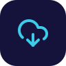
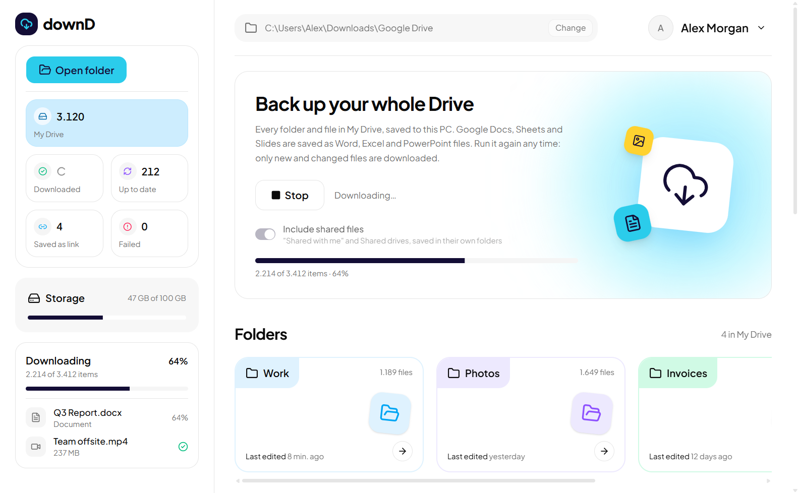

<div align="center">



# downD

**Your whole Google Drive, on your PC, in one click.**

Log in with Google, pick a folder, press **Download all**. downD rebuilds your Drive's folder tree on disk,<br>
converts Google Docs, Sheets and Slides to Office files, and only fetches what changed on the next run.

[](LICENSE)
[](#requirements)
[](#build-from-source)
[](https://ui.shadcn.com/)



</div>

## Why downD?

Google Drive's own "Download" zips a folder at a time, splits large ones into pieces, and starts over when the connection drops. Google Takeout works, but you wait hours for an email and get a pile of ZIP files. downD downloads straight into folders you can browse, and picks up where it stopped.

## Features

| | |
|---|---|
| 📁 **Whole Drive, real folders** | Every folder and file in My Drive, saved with the same structure. No ZIPs to unpack. |
| 📝 **Office formats** | Google Docs → `.docx`, Sheets → `.xlsx`, Slides → `.pptx`, Drawings → `.png`. |
| 👥 **Shared files too** | Optionally include *Shared with me* and Shared drives, each in its own folder. |
| 🔁 **Resumable** | Run it again any time: unchanged files are skipped, interrupted downloads continue. |
| 🔗 **Nothing silently lost** | Files Google won't hand out (Forms, owner-blocked files) are saved as shortcuts that open them in your browser. |
| ♻️ **Retry failures** | Anything that failed is listed with a **Retry** button, even after you restart the app. |
| 🔒 **Read-only and private** | downD can't change or delete anything in your Drive, and there is no server in between. |

## Quick start

1. Download `downD.exe` from the [**Releases**](../../releases) page and run it. *(No release yet? [Build it from source](#build-from-source) in a few minutes.)*
2. Click **Login with Google** and allow access in your browser.
3. Pick where to save, optionally switch on **Include shared files**, and click **Download all**.

> [!NOTE]
> Until downD is verified by Google, the login shows a *"Google hasn't verified this app"* screen.
> Click **Advanced → Go to downD** to continue. downD only asks to *see and download* your files.

### Requirements

- Windows 10 or 11 with Microsoft Edge WebView2 (built into Windows 11, and installed with Edge on Windows 10)
- A Google account

## What you get on disk

```text
Google Drive\
├── Work\                     your My Drive folders and files
│   ├── Q3 Report.docx        ← converted from Google Docs
│   └── Budget 2026.xlsx      ← converted from Google Sheets
├── Photos\
├── Shared with me\           with "Include shared files" on
│   └── Marketing\
├── Shared drives\
│   └── Company Handbook\
└── downD-failed.txt          only if something could not be saved
```

A file that is shared with you *and* added to your My Drive is downloaded once, in My Drive. Drive shortcuts are skipped; the file they point to is saved where it really lives.

### When Google has no file to give

Google Docs, Sheets and Slides only exist on Google's servers, so they can only be exported. downD handles the cases where that fails:

| Situation | What downD does |
|---|---|
| Export over the Drive API's 10 MB limit | Retries through Drive's own *File → Download* link, which often allows larger files |
| Still too large, or a Google Form, Site or My Map | Saves `Name.url`, a shortcut that opens the file in your browser (**Saved as link**) |
| Owner turned off downloading for viewers | Saves a `.url` shortcut as well; Google blocks every download route for these |
| Anything else (network error, quota) | Lists it under **Failed files** with **Retry** and **Retry all**, and in `downD-failed.txt` |

## Privacy and security

- **Read-only access.** downD requests only `drive.readonly`. It cannot edit, move, share or delete anything.
- **No middleman.** Files go straight from Google to your PC. There is no downD server, no analytics and no telemetry.
- **Your login stays on your PC.** The Google token is stored in `%APPDATA%\downD\token.json`. **Log out** deletes it, and you can revoke access any time at [myaccount.google.com/permissions](https://myaccount.google.com/permissions).
- **Open source.** Every line that touches your data is in this repository.

## Build from source

You need Windows, [Python 3.11+](https://www.python.org/downloads/) and [Node.js 20+](https://nodejs.org/).

```bat
git clone https://github.com/arifmuhamadrohmann/downD.git
cd downD
python -m venv .venv
.venv\Scripts\activate
pip install -r requirements.txt pyinstaller
npm --prefix ui install
npm --prefix ui run build
python app.py
```

`python app.py` needs a Google OAuth client first; see the next section.

<details>
<summary><b>Create your Google OAuth client</b> (free, about 10 minutes)</summary>

<br>

1. In the [Google Cloud Console](https://console.cloud.google.com/), create a project and enable the **Google Drive API** (*APIs & Services → Library*).
2. Under *Google Auth Platform → Audience*, choose **External**. Under *Data Access*, add the scope `https://www.googleapis.com/auth/drive.readonly`.
3. While the app is in **Testing**, add your Google account under *Test users*. Testing-mode logins expire after 7 days; set the app to **In production** to avoid that.
4. Under *Clients*, create an OAuth client of type **Desktop app** and download its JSON.
5. Save it as `client_secret.json` next to `app.py`. It is git-ignored; never commit it.

To use your own client with a downloaded `downD.exe`, save the JSON as `%APPDATA%\downD\client_secret.json` instead; it takes precedence over the built-in one.

</details>

<details>
<summary><b>Build the .exe</b></summary>

<br>

```bat
build.bat
```

This builds the UI and then a single `dist\downD.exe` with the UI and `client_secret.json` inside. Google treats the secret of a desktop OAuth client as public, so shipping it in a release is expected.

</details>

<details>
<summary><b>Work on the UI with hot reload</b></summary>

<br>

```bat
npm --prefix ui run dev
set DOWND_DEV_URL=http://localhost:5173
python app.py
```

</details>

### Run the tests

```bat
python -m unittest
```

The tests use fakes for the Drive API, so they need no network or Google account.

## How it works

downD is a small Python app that shows a React page in a native window.

| Path | What it does |
|---|---|
| [`drive.py`](drive.py) | Google login, walking Drive folders, Windows-safe file names, downloading and exporting |
| [`app.py`](app.py) | Opens the window with [pywebview](https://pywebview.flowrl.com/), runs downloads on a background thread and streams progress to the page |
| [`ui/`](ui) | The interface: Vite, React, Tailwind CSS and [shadcn/ui](https://ui.shadcn.com/). [`ui/src/lib/downd.ts`](ui/src/lib/downd.ts) is the bridge to Python |
| [`test_drive.py`](test_drive.py), [`test_app.py`](test_app.py) | Unit tests |
| [`build.bat`](build.bat) | Packs everything into one `.exe` with PyInstaller |

## FAQ

<details>
<summary><b>Is it free?</b></summary>

<br>

Yes. downD is MIT-licensed, and the Google Drive API and Google login cost nothing for this kind of use.

</details>

<details>
<summary><b>Why does Google say the app is unverified?</b></summary>

<br>

Apps that read your whole Drive need a paid yearly security review before Google removes that screen. Until then, unverified apps are limited to 100 users; [using your own OAuth client](#build-from-source) avoids the limit.

</details>

<details>
<summary><b>A big Google Doc became a <code>.url</code> file. Why?</b></summary>

<br>

Google refused to export it through both the API and the regular download link, usually because the converted file is too large or the owner disabled downloads. The `.url` file opens it in your browser so you can still read it or download it by hand.

</details>

<details>
<summary><b>Can I stop and continue later?</b></summary>

<br>

Yes. Press **Stop**, or just close the app. Next time, files already on disk with the same modified date are skipped.

</details>

## Contributing

Issues and pull requests are welcome. Please run `python -m unittest` and `npm --prefix ui run build` before opening a pull request.

## License

[MIT](LICENSE)
